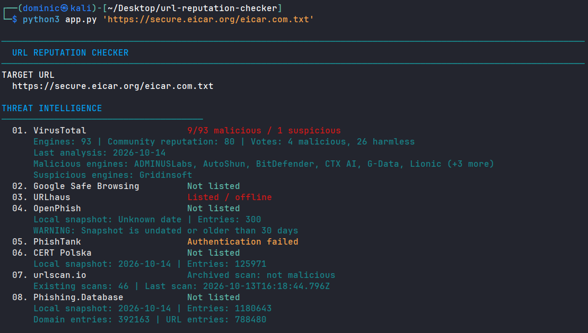
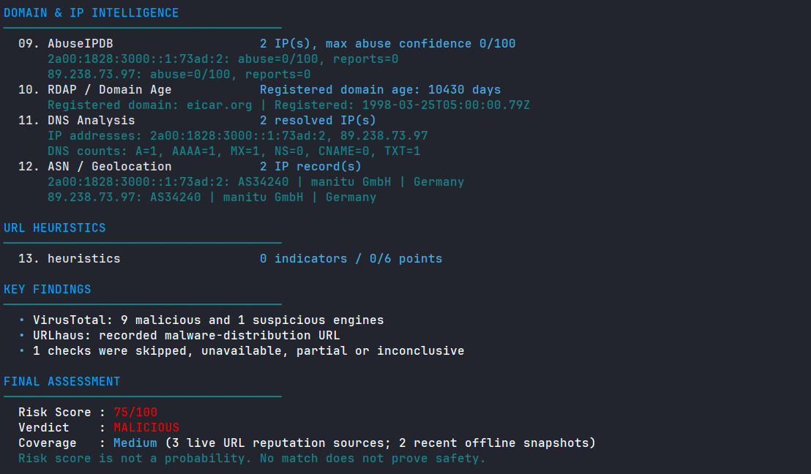

# 🔎 URL Reputation Checker


**Passive URL reputation analysis from your terminal.**

URL Reputation Checker is a Python CLI tool that combines threat intelligence, domain and IP context, and URL heuristics into a single risk assessment. It queries existing intelligence records without directly visiting the submitted website or submitting new scans.

## ✨ Features

- **Threat intelligence:** VirusTotal, Google Safe Browsing, URLhaus, PhishTank, CERT Polska, Phishing.Database, urlscan.io, and an optional user-provided OpenPhish list.
- **Domain and IP intelligence:** DNS records, RDAP registration data, domain age, AbuseIPDB, ASN, and geolocation.
- **URL heuristics:** Typosquatting, brand impersonation, Unicode/Punycode lookalikes, suspicious URL structures, userinfo tricks, shorteners, and defanged URLs.
- **Risk assessment:** A 0–100 evidence-based score, five possible verdicts, and coverage information.
- **CLI workflows:** Single-URL and TXT/CSV batch analysis, JSON/Markdown reports, selectable providers, and automation-friendly exit codes.
- **Privacy controls:** Local API key configuration and optional redaction of sensitive information in reports.

The brand reference data includes **500 global entries**, **75 Türkiye-focused entries**, and **3 compatibility signatures** (PayPal, Google, and GitHub). These references are not a whitelist, and their domains have not all been independently verified.

## 🚀 Getting Started

**Requirements:** Python 3.10+; no external Python packages required.

From the project directory, create your own local `.env` file:

```bash
cp .env.example .env
```

Add the API keys you have, then analyze a URL:

```bash
python3 app.py 'https://example.com'
```

API keys are optional per provider. Sources that require missing credentials are marked as skipped or unavailable rather than reported as clean.

## 💻 Usage

```bash
# Analyze a URL
python3 app.py 'https://example.com/login'

# Analyze a defanged URL
python3 app.py 'hxxps[:]//example[.]com/login'

# Analyze URLs from a TXT or CSV file
python3 app.py urls.txt
python3 app.py urls.csv

# Save a report
python3 app.py 'https://example.com' -o report.json
python3 app.py 'https://example.com' -o report.md

# Redact sensitive URL values in the displayed and saved report
python3 app.py 'https://example.com/login?token=example' --redact-secrets -o report.json
```

TXT files contain one URL per line. CSV files can use a `url` column. On Windows, you can use `py app.py` instead of `python3 app.py`.

## 🖥️ Terminal Output

The following output shows a lookup for the [EICAR anti-malware test file](https://www.eicar.org/download-anti-malware-testfile/). EICAR is a **harmless security test file**, not actual malware. The verdict shown reflects the intelligence sources and scoring rules at the time of the example; it is not an independent confirmation of a malicious website.





## ⚙️ CLI Options

| Option | Description |
|---|---|
| `-o`, `--output FILE` | Save an additional `.json` or `.md` report. |
| `--providers NAMES` | Query only the specified comma-separated provider IDs. |
| `--timeout SEC` | Set a per-request network timeout (default: 10 seconds). |
| `--redact-secrets` | Mask query values and certain sensitive URL components in reports. |
| `--json-stdout` | Print machine-readable JSON to standard output. |
| `--no-color` | Disable ANSI terminal colors. |
| `--fail-on-risk LEVEL` | Return exit code 3 at or above `SUSPICIOUS`, `HIGH`, or `MALICIOUS`. |
| `--fail-on-unknown` | Return exit code 4 if the verdict is `UNKNOWN`. |
| `-h`, `--help` | Show the full CLI help message. |

For example, select only two providers:

```bash
python3 app.py 'https://example.com' --providers virustotal,google_safe_browsing
```

## 🔐 API Configuration

Configure the keys you own in the **local** `.env` file:

```dotenv
VIRUSTOTAL_API_KEY=
GOOGLE_SAFE_BROWSING_API_KEY=
URLHAUS_AUTH_KEY=
PHISHTANK_API_KEY=
URLSCAN_API_KEY=
ABUSEIPDB_API_KEY=
```

Never commit `.env`, API keys, or private reports. The supplied `.gitignore` excludes `.env` and `.env.*` files while keeping `.env.example`. OpenPhish data, if authorized and manually added, remains local and is not included in the public repository.

## 📊 Risk Assessment

| Risk score | Verdict |
|---|---|
| 0–19 | `LIKELY SAFE` or `UNKNOWN`, depending on available evidence |
| 20–44 | `SUSPICIOUS` |
| 45–69 | `HIGH RISK` |
| 70–100 | `MALICIOUS` |

A score is **not a probability**. `LIKELY SAFE` is not proof of safety, and `UNKNOWN` means the available evidence is insufficient for a reliable safe verdict. Strong source evidence and specific detection rules can also enforce minimum risk levels.

## 📁 Project Structure

```text
url-reputation-checker/
├── app.py
├── heuristics.py
├── scoring.py
├── sources.py
├── utils.py
├── data/
│   ├── brands_core_security.json
│   ├── brands_global.json
│   ├── brands_turkey.json
│   ├── public_suffix_list.dat
│   └── feeds/
│       ├── cert_polska.txt
│       ├── metadata.json
│       ├── openphish.txt                
│       ├── phishing_database.txt
│       └── phishing_database_urls.txt
├── assets/
│   ├── terminal-output-1.png
│   └── terminal-output-2.png
├── BRAND_AUDIT.md
├── BRAND_VERIFICATION.csv
├── THIRD_PARTY_NOTICES.md
├── .env.example
├── .gitignore
├── LICENSE
└── README.md
```


## ⚠️ Disclaimer

This tool is intended for security research and defensive URL triage. It does not directly visit the submitted target, but it does make DNS, RDAP, and third-party intelligence queries. **External providers may receive the submitted URL, including sensitive query parameters**; `--redact-secrets` only changes what is displayed or saved, not what providers receive. Do not submit private links or credentials without authorization.

The tool has not yet undergone an independent, labeled real-world accuracy evaluation or complete live-API interoperability verification. Treat its output as evidence for investigation, not as a definitive security decision.

## 📄 License

Released under the [MIT License](LICENSE). Copyright © 2026 **sacitcinar**.

Third-party threat intelligence datasets and Public Suffix List data retain their own licenses and terms; see [THIRD_PARTY_NOTICES.md](THIRD_PARTY_NOTICES.md).
